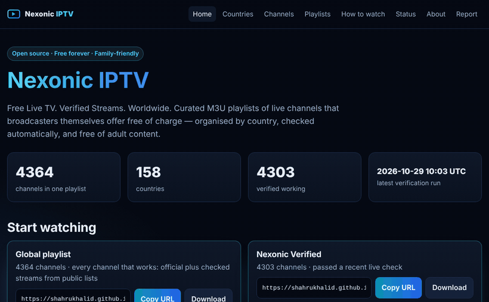

# Nexonic IPTV: free IPTV playlists of official live TV streams (M3U)

**Free-to-air IPTV and public live TV streams, organised by country, language and category, discovered automatically and verified three times a day.**

[](https://github.com/Shahrukhalid/nexonic-iptv/actions/workflows/ci.yml)
[](https://github.com/Shahrukhalid/nexonic-iptv/actions/workflows/verify-streams.yml)
[](https://github.com/Shahrukhalid/nexonic-iptv/actions/workflows/deploy-pages.yml)
[](LICENSE)
[](data/LICENSE)

<p align="center"></p>

Nexonic IPTV is an open-source **IPTV playlist** collection: **M3U playlists of international TV channels** that
broadcasters themselves offer free to the public, such as public broadcasters, news channels and parliaments. Use them
as **free-to-air IPTV** in VLC, Kodi or any IPTV player. There is a playlist for every country, so you can get
**country-specific IPTV** (for example Germany, India or the United States), plus playlists by language and category.
Every stream is checked automatically, every channel records its evidence, and adult-oriented channels are excluded.

Website: https://shahrukhalid.github.io/nexonic-iptv/

> Big and honest: thousands of channels from ten openly licensed sources, and only streams that pass a real check are
> published. Dead or questionable links never reach the playlists.

## Contents

- [Quick start](#quick-start)
- [Login with server, username and password (Xtream Codes)](#login-with-server-username-and-password-xtream-codes)
- [How the playlists are organised](#how-the-playlists-are-organised)
- [Current numbers](#current-numbers)
- [Features](#features)
- [How verification works](#how-verification-works)
- [Scope and legal limits](#scope-and-legal-limits)
- [Contributing](#contributing)
- [FAQ](#faq)
- [Attribution and licenses](#attribution-and-licenses)

## Quick start

Copy a playlist URL and add it as a network stream or M3U source in your player.

| Playlist | URL |
|---|---|
| **Every working channel, in one playlist** | `https://shahrukhalid.github.io/nexonic-iptv/playlists/all.m3u` |
| **Nexonic Verified** (passed a recent check) | `https://shahrukhalid.github.io/nexonic-iptv/playlists/verified.m3u` |
| Channels **waiting for a check** (may not work yet) | `https://shahrukhalid.github.io/nexonic-iptv/playlists/community/untested.m3u` |
| Free movies and series (public domain and open licences) | `https://shahrukhalid.github.io/nexonic-iptv/playlists/vod/movies.m3u` and `.../vod/series.m3u` |
| Free radio (all stations, or one country) | `https://shahrukhalid.github.io/nexonic-iptv/playlists/radio/all.m3u` or `.../radio/countries/de.m3u` |
| Open media (free films, documentaries, science) | `https://shahrukhalid.github.io/nexonic-iptv/playlists/media/all.m3u` |
| Channels by measured quality | `https://shahrukhalid.github.io/nexonic-iptv/playlists/quality/1080p.m3u` (`4k`, `1080p`, `720p`, `sd`) |
| One country | `https://shahrukhalid.github.io/nexonic-iptv/playlists/countries/de.m3u` (replace `de` with a country code) |
| One language | `https://shahrukhalid.github.io/nexonic-iptv/playlists/languages/ar.m3u` (replace `ar` with a language code) |
| One category | `https://shahrukhalid.github.io/nexonic-iptv/playlists/categories/news.m3u` (replace `news` with a category) |

**VLC:** Media, then Open Network Stream, paste a URL and press Play. The channel list opens in the playlist view.

**Kodi:** install the PVR IPTV Simple Client add-on, open its settings, choose remote path and paste the URL as the M3U
playlist URL.

**IPTV apps and Smart TVs:** add the URL as an M3U or "playlist URL" source. Setup guides for Android, iOS and Smart TVs
are on the [How to watch](https://shahrukhalid.github.io/nexonic-iptv/how-to-watch/) page.

The same files are served from
`https://raw.githubusercontent.com/Shahrukhalid/nexonic-iptv/main/playlists/` if you prefer raw GitHub URLs. Every
playlist is listed in [PLAYLISTS.md](PLAYLISTS.md) and on the
[playlists page](https://shahrukhalid.github.io/nexonic-iptv/playlists/).

## Login with server, username and password (Xtream Codes)

Some apps only offer an "Xtream Codes" login instead of a playlist URL. Nexonic IPTV answers those apps too, with the
same channels (grouped by country), the free films under VOD and the free series under Series. Every stream goes
straight to the broadcaster: no video passes through the login service, and only streams in the playlists open.

**Always on (cloud):** choose **Xtream Codes** in your app and enter:

| Field | Value |
|---|---|
| Server URL | `https://nexonic-iptv.shahrukhalid.workers.dev` |
| Username | `nexonic` |
| Password | `free` |

The login is public on purpose: everything here is free, and the apps simply require one. It runs in the cloud around
the clock and always shows the latest playlists; nothing has to stay switched on at home. The same login also gives an
M3U link: `https://nexonic-iptv.shahrukhalid.workers.dev/get.php?username=nexonic&password=free&type=m3u_plus`.

**Run it yourself instead** (on a computer or home server, Python 3.11 or newer):

```bash
git clone https://github.com/Shahrukhalid/nexonic-iptv.git && cd nexonic-iptv
pip install -r requirements.txt
python scripts/xtream_server.py --host 0.0.0.0 --public-url http://<this-computer's-IP>:8080
```

Then use `http://<this-computer's-IP>:8080` as the server URL with the same login. Run `git pull` for new channels;
the gateway reloads them by itself. Maintainers: the cloud setup is described in [cloud/README.md](cloud/README.md).

## How the playlists are organised

- **Country:** `playlists/countries/<code>.m3u` uses the two-letter ISO 3166-1 code and holds the channels of that
  country's broadcasters. Each country also has a page on the website.
- **Language:** `playlists/languages/<code>.m3u` uses the ISO 639-1 code and groups channels by broadcast language,
  whichever country they come from.
- **Category:** `playlists/categories/<category>.m3u` groups channels by genre, for example `news`, `kids`,
  `documentary` or `series`.
- **Free radio:** `playlists/radio/all.m3u` holds working internet radio stations, and
  `playlists/radio/countries/<code>.m3u` one file per country. Refreshed every day.
- **Open media:** `playlists/media/` holds free-licensed and public-domain films, documentaries, animation, science and
  history videos, one file per genre. Each entry names its licence and author.
- **TV guide:** when guide feeds are set in `config/extras.toml`, `playlists/guide.xml.gz` is named in every playlist
  header, so players fill their programme guide automatically.
- **All and Verified:** `all.m3u` holds every published channel. `verified.m3u` holds only channels that passed a
  real check in the last 48 hours and are not quarantined.

All files are generated by `scripts/generate.py` from the records in `data/approved/`, so they always agree with the
channel data. Do not edit them by hand.

## Current numbers

<!-- nexonic:stats:start -->
<!-- Generated by scripts/generate.py — do not edit by hand. -->

Numbers are refreshed by the next playlist build.

<!-- nexonic:stats:end -->

## Features

- **One playlist with everything that works:** channels researched or auto-admitted from broadcasters' own domains,
  plus streams from public, openly licensed lists, all checked automatically. A channel joins the playlists after its
  first successful check and leaves while it is failing. Free films and series from open collections (feature films, noir, comedy, sci-fi and
  horror, silent films, animation, short films, documentaries and classic TV) are in `playlists/vod/`, with a playlist
  per genre and decade. See [docs/TIERS.md](docs/TIERS.md) for the source rules, legal notes and takedown path.
- **Free radio, open media and a TV guide:** working radio stations from around the world, free-licensed films and
  videos, and a programme guide trimmed to the published channels, all updated in the daily run.
- **New source finder:** once a week a report of newly found, openly licensed playlist lists is written to
  [reports/source-candidates.md](reports/source-candidates.md) for review. Nothing is added without the owner's approval.
- **Official tier, official streams only:** the stream host belongs to the broadcaster or its CDN, and an evidence page is recorded
  for every channel ([source policy](docs/SOURCE_POLICY.md)).
- **Two ways into the official tier:** *curated* channels researched by a maintainer, plus *auto-admitted* channels found in a
  public, public-domain channel database whose stream is served from the broadcaster's own domain. Auto-admitted
  channels appear only after they pass a live check.
- **Automatic discovery:** every day at 01:41 UTC new channels are collected from ten openly licensed sources, screened
  (database entry, URL policy, no special headers, adult screening, exclusions) and queued for a check. Nothing is
  published until it works.
- **Checks three times a day** (03:17, 11:17 and 19:17 UTC): new streams are checked first, failing ones are retried
  later, and results are saved even when GitHub's API has a hiccup.
- **Nexonic Verified:** a playlist of channels that passed a real check in the last 48 hours.
- **Layered verification:** URL policy, DNS, bounded HTTP, HLS manifest, media bytes (and optional FFprobe), with SSRF
  protection and polite rate limits.
- **Lifecycle and quarantine:** each channel has a state derived from its check history, and repeatedly failing
  channels are quarantined and restored automatically.
- **Nexonic Health Score:** a transparent 0-100 score from recorded history; "NOT ENOUGH DATA" until it is earned.
- **Nexonic Safe:** adult content excluded by schema, five automated moderation layers, human review and tests
  ([content policy](docs/CONTENT_POLICY.md)).
- **Country Hub:** one playlist and one web page per country, plus language and category playlists.
- **Status page and change report:** public, timestamped results from every run, and a daily
  [change report](reports/changes.md).
- **Xtream Codes login:** an always-on cloud login (and a run-it-yourself version) for apps that ask for a server,
  username and password (`nexonic` / `free`); streams go straight to the broadcasters.
- **Zero cost:** no ads, subscriptions, trackers or accounts; runs on free GitHub Actions and Pages.

## How verification works

Stream verification runs three times a day, at 03:17, 11:17 and 19:17 UTC ([verify-streams.yml](.github/workflows/verify-streams.yml)). Each
channel goes through the layered check described in [docs/VERIFICATION.md](docs/VERIFICATION.md): URL policy, DNS,
manifest, playlist parsing and a read of real video bytes. An HTTP 200 alone is never treated as proof.

Results feed a **lifecycle state** for every published channel: `working`, `intermittent`, `unreachable`, `invalid`,
`restricted` or `unknown`. A channel that fails several checks in a row over at least two days is **quarantined** and
leaves `verified.m3u`. One successful check restores it automatically. A **publication guard** stops a run from
publishing if the channel count drops sharply or jumps unexpectedly, and each run writes a
[change report](reports/changes.md). Thresholds live in [config/pipeline.toml](config/pipeline.toml); the full pipeline
is explained in [docs/AUTOMATION.md](docs/AUTOMATION.md).

Results describe reachability from GitHub-hosted runners at the time of the run. They do not prove that a stream plays
in your location.

## Scope and legal limits

- Nexonic hosts no video. The official tier links only to streams that broadcasters publish free for the public, with a
  documented basis for each. The community and free VOD tiers follow the weaker rules in [docs/TIERS.md](docs/TIERS.md)
  and are labelled as such. It does not bypass DRM, paywalls, logins or region limits.
- Many public broadcasters limit streams to their own country. Those channels are labelled region-limited and will not
  play elsewhere.
- Broadcasters can change or end streams at any time; nothing here is guaranteed.
- No adult-oriented channel is ever published. Uncertain cases are quarantined for review. If you see anything
  inappropriate, [report it](https://github.com/Shahrukhalid/nexonic-iptv/issues/new?template=3-report-adult-content.yml)
  and it will be removed from all playlists.
- Rights holders can request removal through the
  [copyright form](https://github.com/Shahrukhalid/nexonic-iptv/issues/new?template=5-copyright-concern.yml) or
  privately ([SECURITY.md](SECURITY.md)). See [DISCLAIMER.md](DISCLAIMER.md) and [docs/LEGAL.md](docs/LEGAL.md).
- Technical details: playlists use standard extended M3U (`tvg-id`, `tvg-name`, `tvg-country`, `tvg-language`,
  `group-title`) with HLS streams. `tvg-id` values follow the common channel-ID convention, so standard
  programme-guide (EPG) files match them.

## Contributing

Contributors are wanted: suggest channels, share open playlist or EPG sources, find free VOD collections, clean up
broken or duplicate entries, or improve the tooling. The short guide is in
[CONTRIBUTING.md](CONTRIBUTING.md#contributors-wanted).

- **Suggest a channel** with the
  [channel suggestion form](https://github.com/Shahrukhalid/nexonic-iptv/issues/new?template=2-suggest-channel.yml).
  Official evidence that the broadcaster offers the stream free is required.
- **Report a broken stream** with the
  [broken channel form](https://github.com/Shahrukhalid/nexonic-iptv/issues/new?template=1-broken-channel.yml).
- **Report a bug** in the scripts or website with the
  [bug report form](https://github.com/Shahrukhalid/nexonic-iptv/issues/new?template=7-bug-report.yml).
- **Open a pull request:** see [CONTRIBUTING.md](CONTRIBUTING.md).

```bash
pip install -r requirements-dev.txt
pytest                         # unit tests, mocked network
python scripts/validate.py     # schema, provenance, playlist checks, publication guard
python scripts/moderate.py     # adult-content screening
python scripts/verify.py       # live checks (internet required)
python scripts/generate.py     # rebuild playlists, reports and the numbers above
```

## Roadmap

- [ ] Confirm every evidence page by hand (`source.evidence_checked`) and grow coverage country by country.
- [x] TV guide engine: playlists name `playlists/guide.xml.gz` once a guide feed is set in `config/extras.toml`.
- [ ] Choose an openly licensed guide feed.
- [ ] Per-channel history charts on the status page.
- [ ] More openly licensed sources: suggest one in an issue (it needs an open licence file and free-to-air streams only).

## FAQ

Common questions about cost, legality, verification and playback are answered in [FAQ.md](FAQ.md) and on the
[website FAQ](https://shahrukhalid.github.io/nexonic-iptv/faq/).

## Attribution and licenses

- Code: [MIT](LICENSE). Data, playlists, reports and verification history (`data/`, `playlists/`, `reports/`,
  `state/`): [CC0 1.0](data/LICENSE). Scope table: [NOTICE.md](NOTICE.md#licensing-scope).
- Channel IDs, country names/flags and NSFW blocklists come from a public-domain channel database. Sources and
  licences are recorded in [NOTICE.md](NOTICE.md) and `config/pipeline.toml`.
- Channel names and trademarks belong to their owners.

## About this repository

**Description:** Free, open-source, family-friendly IPTV playlists of officially free live TV, organised by country and
automatically verified.
**Topics:** `iptv`, `m3u`, `m3u8`, `playlist`, `free-tv`, `live-tv`, `hls`, `iptv-playlist`, `open-data`,
`github-actions`, `public-broadcasting`, `family-friendly`.
